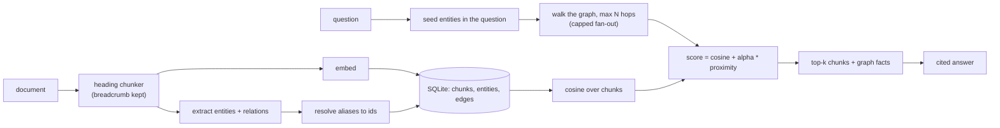

# rag-graph

[](https://github.com/darrshangovender/rag-graph/actions/workflows/tests.yml)
[](LICENSE)
[](https://python.org)
[](https://sqlite.org)

> Knowledge-graph-augmented RAG for questions that connect facts across documents. Entities and relations are extracted per chunk (by rules offline, or by an LLM), merged into a SQLite graph, and retrieval blends vector similarity with a bounded multi-hop walk from the entities named in the question. A bundled synthetic multi-hop benchmark shows what the graph adds, and where it does not help.

**Why this exists.** Vector search is strong on "what does this document say about X" and weak on "which product is made by the company that acquired the company Y founded?", where the evidence sits in three documents and only one of them resembles the question. A graph can follow the links; vectors cover narrative that never reduces to a triple. This is a small, readable implementation of both in one store, with the seams visible and the claim measured by a script.

---

## Quick start

No API key, no network:

```bash
pip install -e ".[dev]"
python examples/demo.py              # four invented documents, one two-hop question
python benchmarks/multihop.py        # vector-only vs graph on 80 synthetic multi-hop questions
```

```text
ingested doc-1: 1 chunk(s), 2 relation(s)
ingested doc-2: 1 chunk(s), 1 relation(s)
ingested doc-3: 1 chunk(s), 1 relation(s)
ingested doc-4: 1 chunk(s), 0 relation(s)

Q: In which city is the company founded by Tamsin Velcott headquartered?

--- vector only (top 2 chunks) ---
Tamsin Velcott is an engineer. [c1] Tamsin Velcott founded Brindle Labs in 2011. [c1] Which city a company is headquartered in matters to its staff, and a company that moves city loses people. [c2]
retrieved: doc-2, doc-4

--- vector + graph (top 2 chunks) ---
Tamsin Velcott is an engineer. [c1] Tamsin Velcott founded Brindle Labs in 2011. [c1] Which city a company is headquartered in matters to its staff, and a company that moves city loses people. [c2]
Graph path: Tamsin Velcott --founded--> Brindle Labs [c1]; Brindle Labs --headquartered in--> Halmouth; Brindle Labs --makes--> Kestrel-4; Orvane Systems --acquired--> Brindle Labs
retrieved: doc-2, doc-4
graph facts:
  Tamsin Velcott --founded--> Brindle Labs (from chunk 2, hop 0)
  Brindle Labs --headquartered in--> Halmouth (from chunk 1, hop 1)
  Brindle Labs --makes--> Kestrel-4 (from chunk 1, hop 1)
  Orvane Systems --acquired--> Brindle Labs (from chunk 3, hop 1)
```

The answer here is *extractive* (it quotes the best-matching sentences and prints the graph path); it is a baseline that shows what was retrieved, not a language model. Both runs retrieve the same two chunks: the generic note outranks the Brindle Labs page, which shares only generic words with the question. The difference is in what the answerer is given. With the graph it also receives `Brindle Labs --headquartered in--> Halmouth`, reached from Tamsin Velcott through the `founded` relation, and that is the answer; vector-only has no way to know it. (Retrieval-quality numbers are in Results below, not in this one example.)

```python
from rag_graph import GraphRAG

with GraphRAG(db_path="kg.db") as rag:                     # offline defaults
    rag.ingest(doc_id="doc-1", text="# Deal\nBig Co acquired Small Co in 2019.")
    result = rag.ask("Who acquired Small Co?", k=5, hops=2)
    print(result.answer, result.cited, result.graph_facts)
```

For real models: `GraphRAG(embedder=OpenAIEmbedder(), extractor_model="claude-sonnet-4-5", answer_model="claude-sonnet-4-5")` (extras: `pip install -e ".[openai]"` / `".[anthropic]"`), or pass your own `Extractor`, `Answerer` or `Embedder` objects. All keyword-only.

## How it works



1. **Chunk** on the heading tree (headings inside code fences are ignored), keep the breadcrumb, split oversize sections on paragraphs, then sentences, then words.
2. **Embed** the breadcrumb plus text (so a page titled "Demis Hassabis" is found by that name) and **extract** entities and relations from the same text.
3. **Resolve** names to entity ids by case-folded, punctuation-free keys ("Open AI", "OpenAI" and "open-ai" are one entity; "AI Bias" and "Bias AI" are not). The resolver is rebuilt from the database, so ids continue across restarts.
4. **Write** the whole document in one transaction. Re-ingesting a `doc_id` replaces it.
5. **Seed** from known entity names found in the question (whole-word, alias-aware); fall back to the extractor on the question only if none are found.
6. **Walk** the graph from the seeds, both edge directions, to `hops`, capped at `max_entities` visited and `max_degree` neighbours per entity. Proximity is `1 / (1 + distance)`. With `traversal="relation_guided"`, an edge whose predicate shares a stem with the question costs 1 and any other edge costs 2, so hubs reached through an unrelated relation fall outside the budget.
7. **Blend** `max(0, cosine) + alpha * graph_proximity` (a chunk's graph score is the best proximity among its entities), sort with a stable tie-break, take the top k.
8. **Answer** from the chunks *and the graph facts* (relation, endpoints, evidence, source chunk label). The answer's `[cN]` markers are validated: `cited` lists real ones, `invalid_citations` the rest.

## Results

All numbers below come from `python benchmarks/multihop.py` on the bundled **SYNTHETIC** data (`data/README.md`): 232 documents, 80 questions (20 one-hop, 40 two-hop, 20 three-hop), 212 graph edges over 197 entities. A test regenerates these tables and fails if the README drifts.

How to read the setup: *vector-only* is the same pipeline with `alpha=0`. Each document is one chunk. *recall@k* is the share of the question's gold documents among the top-k chunks; *full-support@k* means all of them are (the answer can be derived from the context); *answer in context* means the answer string appears in the retrieved text. The corpus is templated and the extractor is rule-based, so **extraction is near-perfect here**; the last table shows what happens when it is not. Embeddings are a lexical hashing embedder (shared words), not a semantic model.

**1. Vector-only vs graph (alpha 0.5, 2 hops), by how many hops the question needs**

| hops | n | metric | vector-only @3 | graph @3 | vector-only @5 | graph @5 | vector-only @8 | graph @8 |
|---|---|---|---|---|---|---|---|---|
| 1 | 20 | recall | 100% | 100% | 100% | 100% | 100% | 100% |
| 1 | 20 | full-support | 100% | 100% | 100% | 100% | 100% | 100% |
| 1 | 20 | answer in context | 100% | 100% | 100% | 100% | 100% | 100% |
| 2 | 40 | recall | 49% | 64% | 50% | 72% | 50% | 80% |
| 2 | 40 | full-support | 0% | 28% | 0% | 45% | 0% | 60% |
| 2 | 40 | answer in context | 0% | 28% | 5% | 52% | 15% | 68% |
| 3 | 20 | recall | 33% | 65% | 33% | 78% | 33% | 82% |
| 3 | 20 | full-support | 0% | 0% | 0% | 40% | 0% | 45% |
| 3 | 20 | answer in context | 0% | 0% | 0% | 40% | 0% | 45% |
| all | 80 | recall | 58% | 73% | 58% | 81% | 58% | 85% |
| all | 80 | full-support | 25% | 39% | 25% | 57% | 25% | 66% |
| all | 80 | answer in context | 25% | 39% | 28% | 61% | 32% | 70% |

**1b. Traversal mode (k=5)**

| retrieval | recall@5 (2-hop) | full-support@5 (2-hop) | recall@5 (3-hop) | full-support@5 (3-hop) | full-support@5 (all 80) |
|---|---|---|---|---|---|
| vector-only | 50% | 0% | 33% | 0% | 25% |
| graph, uniform traversal | 72% | 45% | 78% | 40% | 57% |
| graph, relation-guided traversal | 72% | 45% | 83% | 50% | 60% |

**1c. By question type (full-support@5)**

| question type | hops | n | vector-only | graph (uniform) | graph (relation-guided) |
|---|---|---|---|---|---|
| hq | 1 | 10 | 100% | 100% | 100% |
| product | 1 | 10 | 100% | 100% | 100% |
| acquirer>founder | 2 | 10 | 0% | 0% | 0% |
| acquirer>hq | 2 | 10 | 0% | 10% | 10% |
| founder>hq | 2 | 10 | 0% | 100% | 100% |
| founder>product | 2 | 10 | 0% | 70% | 70% |
| founder>acquirer>product | 3 | 10 | 0% | 80% | 100% |
| founder>hq>country | 3 | 10 | 0% | 0% | 0% |

**2. Blend weight alpha (2 hops, k=5)**

| alpha | recall@5 (2-hop) | full-support@5 (2-hop) | recall@5 (3-hop) | full-support@5 (3-hop) | recall@5 (1-hop) |
|---|---|---|---|---|---|
| 0 | 50% | 0% | 33% | 0% | 100% |
| 0.25 | 51% | 2% | 33% | 0% | 100% |
| 0.5 | 72% | 45% | 78% | 40% | 100% |
| 1 | 81% | 62% | 80% | 40% | 100% |
| 2 | 86% | 72% | 80% | 40% | 100% |

**3. Traversal depth (k=5; depth 0 means the seed entities only)**

| traversal depth | full-support@5 (2-hop) | full-support@5 (3-hop) |
|---|---|---|
| 0 | 0% | 0% |
| 1 | 48% | 0% |
| 2 | 45% | 40% |
| 3 | 42% | 30% |

**4. Extraction recall: what if the extractor misses relations (k=5)**

| relations kept by the extractor | graph recall@5 (2-hop) | graph full-support@5 (2-hop) | graph full-support@5 (3-hop) |
|---|---|---|---|
| 100% | 72% | 45% | 40% |
| 70% | 61% | 22% | 30% |
| 40% | 60% | 20% | 10% |
| 0% | 50% | 0% | 0% |

What this shows, and what it does not:

- **One-hop questions are solved by both (100%), so the graph costs nothing there.** On multi-hop questions vector-only full-support is 0% *by construction* (the later documents share no distinctive word with the question), and the graph lifts it to 45% (2-hop) and 40% (3-hop) at k=5, 57% overall against 25%.
- **It is far from solved.** Two question types stay at or near 0% with the default settings: "who founded the company that acquired X" (a lexical distractor outranks the founder page: other companies whose names share a word with X) and "in which country is the city where the company founded by P is headquartered" (a city page shares no word with the question and competes with every company in that hub city). Relation-guided traversal helps the three-hop product questions (80% to 100%) and nothing else here.
- **Depth and weight are knobs, not free lunches.** A larger `alpha` helps this benchmark (table 2) but would also let a noisy graph override good vector hits; depth 3 is worse than depth 2 for 3-hop questions (table 3) because the walk reaches hub entities.
- **The graph is only as good as extraction.** With 70% of relations kept, 2-hop full-support falls from 45% to 22%; with none it is 0% and the pipeline is plain vector search (table 4).
- **This is a demonstration of a mechanism on invented, templated data**, with a lexical embedder and a perfect-ish extractor. It is not a measurement of how an LLM extractor or a semantic embedder would do on your documents, and it makes no claim about real corpora. To test those, implement `Extractor` / `Embedder`, point the benchmark at your own `corpus.jsonl` and `questions.jsonl` (same format), and read tables 1 to 4.

## Design decisions

| Decision | Why |
|---|---|
| **Hybrid, not pure graph** | A graph only knows what was extracted as a triple. Vectors catch the narrative knowledge that never reduces to (entity, predicate, entity). |
| **The graph's facts go to the answerer, not just into the ranking** | The first version used the graph only to reweight chunks; the model never saw a triple. Facts carry their evidence quote and the source chunk label. |
| **Relations connect through shared entities** | A triple lives in one chunk, but its entities are merged across the whole corpus by the resolver, so `A founded B` (chunk 1) and `C acquired B` (chunk 2) are linked through `B`. Multi-document connections are the graph's job, not the extractor's. |
| **Rule-based extractor offline, LLM optional** | Tests, demo and benchmark need no key and are deterministic. The LLM extractor is Pydantic-validated and takes an injectable `chat` transport. |
| **Re-ingest replaces; a document is one transaction** | Ingesting twice used to duplicate chunks and edges; a failure part-way used to leave half a document. |
| **Resolver rebuilt from the store** | It used to restart at id 1 in every process and overwrite existing entities while their edges still pointed at them. |
| **Dimension is checked, not assumed** | A store built with another embedder used to score 0.0 against everything, silently. |
| **Bounded traversal** | `max_entities` and `max_degree` stop a hub entity from fanning out to the whole graph. |
| **Failures are counted** | `IngestReport.extraction_errors`, `dropped_triples` and `dropped_entities` replace a bare `except` that made an API outage look like an empty chunk. |

## Limitations

- **The offline pieces are weak on purpose.** The rule-based extractor needs capitalised names and its fixed patterns (founded, acquired, headquartered in, makes, located in, CEO of); a capitalised sentence opener becomes part of a name ("Yesterday Ann Lee"); pronouns and coreference are not resolved. The hashing embedder matches shared words, not meaning. The extractive answerer cannot reason or paraphrase.
- **Retrieval is not solved by the graph.** See the weak question types above. Undirected, unweighted traversal treats a hub entity (a city with many companies) like a specific one, and the lexical distractor problem remains. `relation_guided` is a heuristic keyed on word stems (it does not know that "made" is "makes").
- **Entity resolution is string-based.** Two different people with the same name merge; "Apple the company" and "apple the fruit" merge; nicknames and acronyms do not. `sort_tokens=True` also merges reordered names ("Smith John"), at the price of false merges.
- **Vector search is exact and in-memory.** One numpy matrix product per query over all chunks (rebuilt when the chunk table changes): fine for thousands of chunks, not for millions, and the matrix is held in RAM. No ANN index, and embeddings are stored as JSON text.
- **The score blend is a heuristic.** `cosine + alpha * proximity` adds two unlike quantities; `alpha` was not tuned on held-out data, and the table above is on the same data it is reported on.
- **No citation verification beyond range.** `[cN]` markers are checked to exist, not to be supported by the cited chunk.
- **Embedded SQLite, not a server.** Several `GraphRAG` objects or processes may share one file on a local disk: writes are serialised (`BEGIN IMMEDIATE`, WAL, busy timeout) and each object rebuilds its entity index when another connection has written (`PRAGMA data_version`), but this is tested with threads and with two processes on one machine, not with many processes or a network drive. There is no auth, and graph facts are deleted only with their document (entities are never garbage-collected).
- **The LLM extractor and answerer are exercised only with fake transports in the tests**, never against a real model here.

## Project layout

```
rag-graph/
├── rag_graph/
│   ├── core.py         # GraphRAG: ingest, ask; IngestReport, AnswerResult
│   ├── chunker.py      # heading-aware splitter
│   ├── extractor.py    # RuleBasedExtractor (offline) and EntityRelationExtractor (LLM)
│   ├── resolver.py     # surface normalisation, alias merging, rebuilt from the store
│   ├── store.py        # SQLite: chunks, entities, edges, joins; numpy vector scores
│   ├── retriever.py    # seeds, bounded graph walk, blend, graph facts
│   ├── answerers.py    # ExtractiveAnswerer (offline), LLMAnswerer
│   └── embeddings.py   # HashingEmbedder (offline), OpenAIEmbedder
├── benchmarks/multihop.py     # the tables above
├── data/                      # SYNTHETIC corpus, questions, generator
├── examples/demo.py
└── tests/                     # 216 tests
```

## Tests

```bash
pytest tests/        # 216 passed, offline, no keys
ruff check .         # 0 findings
```

Covered: the chunker (fences, closing hashes, size guarantee, never losing text), the resolver and its rehydration from the store, the store (transactions, dimension safety, vector scores against a plain-Python cosine, cache refresh, concurrent writers), both extractors, the retriever (whole-word seeds, bounded walks, blend arithmetic, determinism), `GraphRAG` end to end (idempotent re-ingest, ids across restarts, atomic failure, citations), and the benchmark's data and claims, including that the README tables are exactly what the script prints.

Built by [Darrshan Govender](https://github.com/darrshangovender) · [Agulhas Code](https://agulhascode.co.za)
